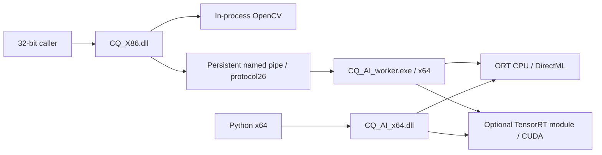

# Architecture

CQ_AI is a Windows C++17 library with a stable C ABI (60 public functions).

YOLO shares preprocessing, decoding and backend selection across x86 and x64.
Session count is execution-slot capacity, separate from callers and ORT threads.
Each DirectML Session serializes Run; each TensorRT slot owns its context, stream
and buffers. BMP views, reusable workspaces and request IDs cover the common path.
OCR retains devices0..2 and ORT. CV runs in the host DLL.

Transparent compatibility matching excludes candidates using bounds over actual
visible pixels, then confirms scores with integer moments. Sparse masks use
orthogonal pixel-pair projection; larger masks retain the complete FFT fallback.
Ordinary color multi-template matching can use eight overlapping tiles within
one leased workspace, with at most seven temporary helpers. Final exact scores,
NMS and result ordering remain sequential. All scratch storage counts toward
the bounded workspace pool. See [numerical/resource details](CV_MASKED_PROJECTION_NUMERICS.md).

At load time `yolo_model.h` reads bounded ONNX metadata and graph descriptors,
skipping weights. A model pool shares the immutable descriptor with every slot.
The decoder handles dense, objectness and native end-to-end outputs through
strided views without transposing tensors. Native end-to-end skips a second NMS;
ordinary heads retain the existing class-agnostic NMS. TensorRT private ABI3
carries this descriptor; public ABI and Worker protocol26 remain unchanged.

The core Worker embeds its fixed ORT/DirectML runtime and OCR assets; optional
NVIDIA dependencies remain a separate package. A model pool owns the backend and
leases slots with RAII. Runtime status identifies the actual backend/device.

Repository flow: source + locked dependencies -> build -> verified candidate ->
HTML/archives -> cohort promotion. `release/current.json` locates the immutable
current manifest; `output/` is the local three-file deployment directory.

Detailed source mapping: [project guide](PROJECT_GUIDE_CN.md).
